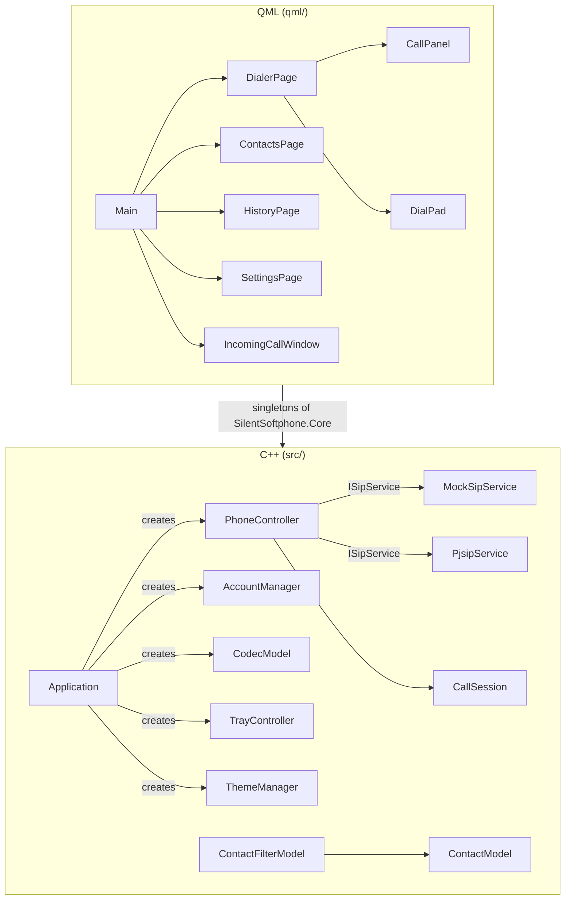

# Architecture · Архітектура

[English](#english) · [Українська](#українська)

## English

### Principles

- **Dependency inversion.** `PhoneController` only knows the abstract `ISipService`.
  The mock, PJSIP or another stack is chosen in one place, `Application`.
- **One composition root.** `Application` creates and wires all objects; QML receives
  them as singletons of the `SilentSoftphone.Core` module.
- **No logic in the UI.** QML shows state and calls `Q_INVOKABLE` methods. Rules such as
  "one active call", history records and SIP URI building live in C++.
- **Qt models.** Lists are `QAbstractListModel`s; search and sorting use `QSortFilterProxyModel`.

### Classes

| Class | Responsibility |
|---|---|
| `ISipService` | Abstract SIP stack boundary: registration, calls, hold, mute, DTMF, media info, codecs |
| `PjsipService` | Implementation on PJSIP pjsua2 |
| `MockSipService` | In-process PBX simulation for development and tests |
| `CallSession` | One call: direction, state, duration, mute, live audio levels, codec |
| `PhoneController` | Call workflows for the UI, current call, history records |
| `AccountManager` | SIP accounts, the active account, persistence; QML list model |
| `CallSettings` | DTMF method, key tones |
| `CodecModel` | Stack codecs: enable/disable, order → priorities, persistence |
| `ContactModel` / `ContactFilterModel` | Contacts and search |
| `CallHistoryModel` | Call log |
| `ThemeManager` | Light/dark palettes; System mode follows the OS |
| `TrayController` | Tray icon with status and missed calls, menu, show/hide window |
| `WindowSettings` | Close/minimize to tray |
| `AutoStart` | Start with the system: `Run` registry key on Windows, LaunchAgent on macOS |
| `Diagnostics` | Log file location, "Open log folder", call simulation in mock mode |
| `SmokeTest` | CI scenario: state-driven steps with timeouts, screenshots |

### QML API (`import SilentSoftphone.Core`)

| Singleton | Type |
|---|---|
| `Theme` | `ThemeManager` |
| `Phone` | `PhoneController` |
| `Accounts` | `AccountManager` |
| `CallSettings` | `CallSettings` |
| `Codecs` | `CodecModel` |
| `Contacts` | `ContactFilterModel` |
| `History` | `CallHistoryModel` |
| `Diagnostics` | `Diagnostics` |
| `Tray` | `TrayController` |
| `WindowSettings` | `WindowSettings` |
| `AutoStart` | `AutoStart` |

### PJSIP integration

- **Build.** `tools/build_pjsip.sh` builds PJSIP 2.17 with its CMake build (static, audio only);
  the app links `Pj::pjsua2`. TLS is off for now: the PJSIP 2.17 CMake build does not support the
  Schannel/Apple backends yet, so TLS will come through OpenSSL.
- **Threads.** PJSIP runs without worker threads (`threadCnt = 0`). A `QTimer` calls
  `libHandleEvents` every 10 ms, so all pjsua2 callbacks and signals arrive on the GUI thread.
  Audio runs on the sound device's own threads.
- **Call state changes** are queued (`Qt::QueuedConnection`) so `PhoneController` creates the
  `CallSession` before the first event arrives.
- **`pj::Call` objects** are deleted after `DISCONNECTED`, outside the callback.
- **Incoming calls** get `180 Ringing` right away; declining answers `603 Decline`.
- **DTMF** uses `Call::sendDtmf`; in Auto mode RFC 2833 first, SIP INFO if that fails
  (no `telephone-event` in the remote SDP).
- **Key tones** use a `pj::ToneGenerator` connected to the speaker only while playing, so the
  sound device can close when idle.
- **Audio levels** come from `AudioMedia::getRxLevel/getTxLevel` of the call port, polled
  10 times a second. In pjsua2 "Rx" is bridge → call port, i.e. what we send.

## Українська

### Принципи

- **Інверсія залежностей.** `PhoneController` знає лише абстрактний `ISipService`.
  Mock, PJSIP чи інший стек обирається в одному місці — в `Application`.
- **Один composition root.** `Application` створює та зв'язує всі об'єкти; QML отримує їх
  як singleton-и модуля `SilentSoftphone.Core`.
- **UI без логіки.** QML показує стан і викликає `Q_INVOKABLE` методи. Правила на кшталт
  «один активний дзвінок», записи в історію та формування SIP URI — у C++.
- **Моделі Qt.** Списки — `QAbstractListModel`; пошук і сортування — `QSortFilterProxyModel`.

### Класи

| Клас | Відповідальність |
|---|---|
| `ISipService` | Абстрактна межа SIP-стека: реєстрація, дзвінки, hold, mute, DTMF, медіа, кодеки |
| `PjsipService` | Реалізація на PJSIP pjsua2 |
| `MockSipService` | Симуляція АТС у процесі для розробки й тестів |
| `CallSession` | Один дзвінок: напрям, стан, тривалість, mute, рівні звуку, кодек |
| `PhoneController` | Сценарії дзвінків для UI, поточний дзвінок, записи в історію |
| `AccountManager` | SIP-акаунти, активний акаунт, збереження; модель списку для QML |
| `CallSettings` | Метод DTMF, тони клавіш |
| `CodecModel` | Кодеки стека: увімкнення/вимкнення, порядок → пріоритети, збереження |
| `ContactModel` / `ContactFilterModel` | Контакти та пошук |
| `CallHistoryModel` | Журнал дзвінків |
| `ThemeManager` | Світла/темна палітри; режим System слідує за ОС |
| `TrayController` | Іконка в треї зі статусом і пропущеними, меню, показ/приховування вікна |
| `WindowSettings` | Закриття/згортання в трей |
| `AutoStart` | Автозапуск: ключ реєстру `Run` на Windows, LaunchAgent на macOS |
| `Diagnostics` | Розташування журналу, «Open log folder», симуляція дзвінка в mock-режимі |
| `SmokeTest` | Сценарій для CI: кроки, що чекають стану з тайм-аутом, скріншоти |

### QML API (`import SilentSoftphone.Core`)

Singleton-и ті самі, що в англійському розділі вище.

### Інтеграція PJSIP

- **Збірка.** `tools/build_pjsip.sh` збирає PJSIP 2.17 через його CMake (статично, лише аудіо);
  застосунок підключає `Pj::pjsua2`. TLS поки вимкнено: CMake-збірка PJSIP 2.17 ще не підтримує
  Schannel/Apple, тому TLS з'явиться через OpenSSL.
- **Потоки.** PJSIP працює без робочих потоків (`threadCnt = 0`). `QTimer` кожні 10 мс викликає
  `libHandleEvents`, тож усі колбеки pjsua2 і сигнали надходять у GUI-потоці. Аудіо обробляють
  власні потоки звукового пристрою.
- **Зміни стану дзвінка** ставляться в чергу (`Qt::QueuedConnection`), щоб `PhoneController`
  створив `CallSession` до першої події.
- **Об'єкти `pj::Call`** видаляються після `DISCONNECTED`, поза колбеком.
- **Вхідний дзвінок** одразу отримує `180 Ringing`; відхилення відповідає `603 Decline`.
- **DTMF** — через `Call::sendDtmf`; у режимі Auto спершу RFC 2833, а якщо не вдалося
  (немає `telephone-event` у SDP співрозмовника) — SIP INFO.
- **Тони клавіш** — `pj::ToneGenerator`, підключений до динаміка лише під час відтворення,
  щоб звуковий пристрій міг закриватися в простої.
- **Рівні звуку** — `AudioMedia::getRxLevel/getTxLevel` порту дзвінка, 10 разів на секунду.
  У pjsua2 «Rx» — це напрям міст → порт дзвінка, тобто те, що ми відправляємо.
